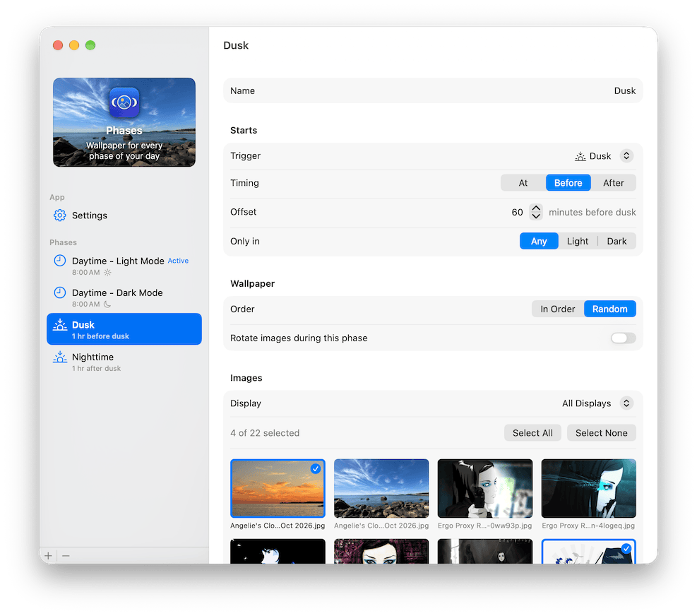

# Phases

Wallpaper for every phase of your day.

Phases is a macOS menu bar app that changes your desktop wallpaper on a
schedule. You split the day into phases, such as "Morning", "Dusk", and
"Night", give each one a set of images from a folder, and Phases switches
between them at the right time, with a crossfade.

It's a personal project, not on the App Store, and still in active
development.



## Origin

My friends share sky photos in a `cloud-game` channel on our Discord server. Some of them are pretty amazing. I wanted my Mac’s screens to feature them, but I also like different desktop pictures at different times of day, and I like variety.

That inspired this little Mac utility. It scratches an itch. It supports sets of wallpapers that activate at arbitrary times of day, including dawn & dusk with optional offsets, and sets can apply to macOS’s Light or Dark appearance (or neither). It can shuffle, or not. It can have different sets for each screen, or not. It can crossfade, or not.

It isn’t the best app ever, but it’s mine, so I like it. Maybe you’ll find it useful too. Enjoy.

## What it does

1. **Phases with start times.** A phase can start at a clock time, at civil
   dawn or dusk (calculated on your Mac, no network calls), or at dawn or
   dusk plus an offset. One phase is always active.
2. **Rotation.** Within a phase, Phases can change to the next image every
   few minutes or hours, in random order or by filename.
3. **Light and Dark Mode.** A phase can apply only in Light or only in Dark
   Mode, so you can have darker images whenever Dark Mode is on.
4. **Multiple displays.** Every display can share one set of images, or a
   display can have its own (ultrawide images for an ultrawide, portrait
   images for a portrait monitor). Settings survive unplugging and
   reconnecting.
5. **Crossfades.** macOS has no transition for wallpapers set by apps, so
   Phases fades the new image in itself. It respects Reduce Motion.
6. **Catches up after sleep.** On wake, Phases shows the image that would be
   showing had the Mac stayed awake, rather than replaying every missed
   change.
7. **Puts your wallpaper back.** By default, quitting restores the
   wallpaper you had before Phases started.

Phases lives in the menu bar (no Dock icon). Everything else, including
Settings and Quit, is in one window, opened from the menu.

## Privacy and permissions

- **Location** is requested only when a phase first uses dawn or dusk, and
  only to calculate those times. Clock-time phases work without it.
- **No screen recording.** Crossfades are drawn from the image files.
- **Launch at Login is off** until you turn it on, and asks before
  registering. It uses a standard Login Item; Phases installs no launch
  agents, daemons, or helpers.
- No network access, analytics, or accounts.

## Requirements

- macOS 26 or later
- A folder of images (JPEG, PNG, HEIC, or TIFF)

## Building

Phases is built with [Bitrig](https://bitrig.app). The project is defined
by `Project.json` rather than a checked-in Xcode project, so the easiest
way to build it is to open the repository in Bitrig.

The unit tests are a separate Swift package and don't need Bitrig or Xcode
project files:

```sh
cd UnitTests
swift test
```

The tests never launch Phases, so running them doesn't touch your
wallpaper.

## Known limitations

- **Only the current Space.** macOS has no public way for an app to set the
  wallpaper on every Space, so Phases changes the active Space on each
  display.
- **Aerials can't be restored.** If you were using an Aerial or other
  system wallpaper before Phases, that display is left alone on quit rather
  than replaced with a still image.
- **The menu bar can lag.** It sometimes blinks at the end of a change, or
  keeps its old style until you switch apps. That's macOS behavior Phases
  can't fix (reported to Apple as FB25326597).

## Project documentation

Two documents carry the design:

- **[SPEC.md](SPEC.md)** says what Phases does and why. Deliberate
  decisions carry a `[D-…]` tag, which also appears in the code that
  enforces them.
- **[ERRATA.md](ERRATA.md)** records what macOS, SwiftUI, and AppKit do to
  Phases and how it works around them. Each quirk has a `[Q-…]` tag.

Search for a tag to find the spec, the workaround, the code, and its tests
together. If you're changing behavior, read the decision first; the spec
gets updated before the code does.

Diagnostic logging is built in and off by default. See "Diagnostics" in
SPEC.md for how to turn it on.

## Copyright

Copyright © 2026 Robert Mohns.
